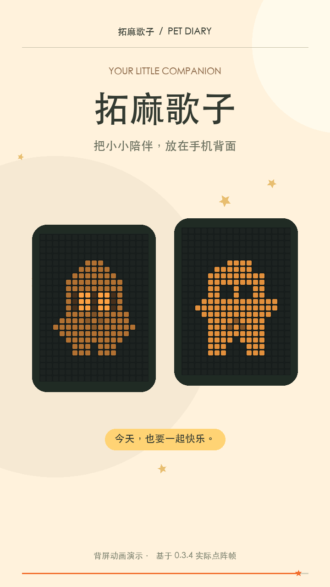

# 拓麻歌子 · Neo 背屏电子宠物

让 STEPX Neo 背面的 17×23 点阵住进一只可以照料、成长和换装的小伙伴。正面是 Mori 3D 养成世界，背面是对应的像素形象，两边共用同一份进度。

**当前版本：0.3.4** · [下载 APK](https://github.com/JiayuStudio/stepx-neo-pet/releases/tag/v0.3.4) · [更新记录](CHANGELOG.md) · [StepX Neo 研究所](https://github.com/JiayuStudio/stepx-neo-lab)

[](https://github.com/JiayuStudio/stepx-neo-pet/releases/download/v0.3.4/tamagochi-promo-60s.mp4)

[观看／下载 60 秒宣传片](https://github.com/JiayuStudio/stepx-neo-pet/releases/download/v0.3.4/tamagochi-promo-60s.mp4) · 竖屏动画演示，非真机实拍；配乐由 Suno 生成。

## 可以做什么

- 喂食、陪玩、洗澡、休息、拥抱和探索，照顾饱食、心情、清洁、精力与健康。
- 三个成长阶段、三种性格、五段回忆剧情和照料事件。
- 接星星、记忆信号两款小游戏，获得星屑，兑换饰品和房间摆件。
- 四个主题世界，JSON 存档导出与恢复。
- 新领养从蛋开始，经历裂纹、破壳与幼体；已有存档可继续使用。
- 星跃与方跃两种角色，可切换耳机；17×23 点阵保留小尺寸五官、短手脚、眨眼与小跳。
- 双角色、耳机、成长、性格、穿戴与动作组合，共 1014 组角色及孵化动画，另有默认帧。
- 手机导航避开状态栏，前台背屏预览与原生显示共用点阵数据。
- 原生前台服务负责养成计时和背屏逐帧输出；离开正面页面后仍可运行。通知和 App 内均有停止入口。

## 安装与开始陪伴

适用于带有兼容背屏接口的 STEPX Neo，最低 Android 14。其他手机的点阵硬件不在支持范围内。

1. 从 [v0.3.4 发布页](https://github.com/JiayuStudio/stepx-neo-pet/releases/tag/v0.3.4) 下载 `diandian-native-0.3.4.apk`，按 Android 提示安装。已有同签名原生版可覆盖升级；升级前可在“存档”导出备份。
2. 打开“拓麻歌子”，允许通知，点“开启背屏”。一次只运行一个背屏播放器。
3. 打开“后台设置”，允许后台运行并关闭本应用的电池优化。
4. 把背屏朝上或竖直放置，保持无遮挡，锁屏观察动作是否继续。
5. 点“停止陪伴”会清除自定义画面并恢复之前的系统背屏模式。

游戏和存档离线运行，不需要账号或 API Key。APK 未申请联网、摄像头、麦克风或定位权限。卸载前请导出存档。

## 锁屏后不动时

部分 Neo 固件会冻结后台进程，仅开启“允许后台运行”仍可能暂停动画。APK 无权自行更改这个系统策略。需要时，可在已授权的 ADB 连接下，为这个 App 单独加入 Neo 冻结例外：

```sh
adb shell dumpsys activity freeze whiteAdd com.diandian.neopet
adb shell dumpsys activity freeze whitelist
```

确认名单中出现包名后，正常打开 App，再开启背屏。若系统不支持命令或拒绝执行，请停止并检查固件兼容性。撤销此例外：

```sh
adb shell dumpsys activity freeze whiteRemove com.diandian.neopet
```

强行停止、重启或固件策略变化后可能需要重新打开 App。背屏朝下、省电、过热等系统条件也可能关闭实际发光。当前版本没有承诺永久后台存活，也不自动在开机后启动。

## 已验证范围

0.3.4 已完成最终源码重建、同签名覆盖安装与系统版本核对；用户已确认真机背屏动画和锁屏持续运行成功。本版没有记录独立计时的锁屏时长，不沿用旧版时长作为本版测试数据。

5600 项点阵检查通过；浏览器实际检查了安全区、导航按钮、锚点避让和无横向溢出。Studio 构建及 19 项预览适配回归通过。原生后台服务和显示会话与 0.3.3 相同。

长期耗电、脱离充电的深度待机、重启恢复及全部固件组合仍待验证。完整养成、小游戏、奖励、装备和文件备份流程曾在 0.3.0 验证，本轮未逐项重测。

## 从源码构建

需要 Node.js 22.18+ 或 24、Python 3、JDK 17+、Android SDK API 36 和 build-tools 36.0.0。配置 `JAVA_HOME` 与 `ANDROID_HOME`。

```sh
cd web
npm ci --ignore-scripts
npm run build
cd ..
node tools/build-engine.mjs
node tools/export-art.mjs
node tools/test-art.mjs
python3 tools/test-mori.py
python3 tools/build.py
```

APK 输出至 `artifacts/`。默认构建会在仓库旁的 `.private/diandian-android/` 生成自己的开发签名；自行构建的签名与发布 APK 不同，不能直接覆盖安装发布版。请先导出存档，或持续使用同一签名构建。发布签名可通过 `tools/build.py --release --keystore ... --ks-key-alias ... --ks-pass-env ...` 显式指定。

| 路径 | 内容 |
| --- | --- |
| `app/` | Android 原生服务、界面桥接、背屏接口和离线页面 |
| `web/src/` | React 界面、3D 场景与小游戏 |
| `vendor/mori-game/` | 保留的上游养成模块 |
| `engine/` | 独立于 WebView 的养成运行宿主 |
| `studio-art/mori.ts` | 可编辑的 17×23 点阵绘制与动画 |
| `tests/`、`tools/` | 验证与构建脚本 |

## 开源来源

实际复用 [Tamagochi / Mori](https://github.com/Tech-aficionado/Tamagochi---Open-Source-Game) 的养成模块、3D 场景、小游戏和界面，按 MIT 许可适配。背屏会话与构建工具基于 [backscreen-toolbox](https://github.com/stepx-advance/backscreen-toolbox)，养成脚本由未修改的 Rhino 运行。来源、固定版本和修改范围见 [NOTICE.md](NOTICE.md)。

本项目原创部分采用 [MIT 许可](LICENSE)，第三方代码与资源遵循各自许可。Rhino 的 MPL-2.0 许可和对应源码随仓库提供。项目未使用商业拓麻歌子角色或 ROM。
