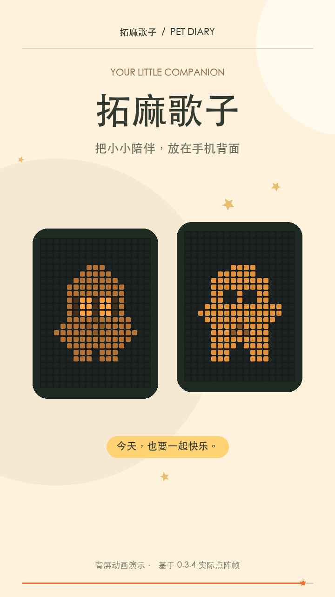

# 拓麻歌子 · Neo 背屏电子宠物

让 STEPX Neo 背面的 17×23 点阵住进一只可以照料、成长和换装的小伙伴。正面是 Mori 3D 养成世界，背面是对应的像素形象，两边共用同一份进度。


**当前版本：0.3.9** · [下载 APK](https://github.com/JiayuStudio/stepx-neo-pet/releases/tag/v0.3.9) · [更新记录](CHANGELOG.md) · [StepX Neo 研究所](https://github.com/JiayuStudio/stepx-neo-lab)

[](https://github.com/JiayuStudio/stepx-neo-pet/releases/download/v0.3.4/tamagochi-promo-60s.mp4)

[观看／下载 60 秒宣传片](https://github.com/JiayuStudio/stepx-neo-pet/releases/download/v0.3.4/tamagochi-promo-60s.mp4) · 竖屏动画演示，非真机实拍；配乐由 Suno 生成。

## 可以做什么

- 喂食、陪玩、洗澡、休息、拥抱和探索，照顾饱食、心情、清洁、精力与健康。
- 三个成长阶段、三种性格、五段回忆剧情和照料事件。
- 接星星、记忆信号两款小游戏，获得星屑，兑换饰品和房间摆件。
- 四个主题世界，JSON 存档导出与恢复。
- 新领养从蛋开始，经历裂纹、破壳与幼体；已有存档可继续使用。
- 星跃、方跃、芽灵、绒兔、焰狐、泡獭、眠鸮、角龙共8只原创宠物，可切换耳机。
- 每只15种场景、每段8帧，共120段基础动画；成长、性格、饰品与耳机外观同步。饥饿、不开心、生病、自然告别均有独立动画。低健康可通过照料恢复，不会因为离线或勿扰直接告别。
- 手机导航避开状态栏，前台背屏预览与原生显示共用点阵数据。
- 原生前台服务负责养成计时和背屏逐帧输出；离开正面页面后仍可运行。通知和 App 内均有停止入口。

## 0.3.9 的陪伴方式

- 默认「温柔陪伴」：幼年、成年、老年持续相伴，不会自然告别。另可确认开启「生命周期模式」，从开启时重新计龄，满 60 天自然告别；55 天起进入暮年。
- 生病、饥饿、想念、成长与康复会产生本地消息和短暂背屏动作；告别后保留纪念，重新领养需确认。
- 「陪伴」导航可直达勿扰和消息。手动勿扰、定时勿扰、仅工作日均可设置，支持跨午夜。默认夜间 22:00–08:00 静默；勿扰时背屏继续安静陪伴。
- 主动通知和轻震动默认关闭。开启背屏陪伴后，原生服务按规则投递本机消息，无需推送服务器。低频每天最多 2 条、间隔 6 小时；普通每天最多 4 条、间隔 3 小时。遵守系统勿扰、静音和通知权限；被抑制的消息不补发。
- 「测试提醒」只验证当前通知设置，不消耗消息额度；实际震动由系统通知渠道决定。
- [隐私说明](PRIVACY.md)：游戏和消息本机计算；只有手动检查更新会访问 GitHub。

## 安装与开始陪伴

适用于带有兼容背屏接口的 STEPX Neo，最低 Android 14。其他手机的点阵硬件不在支持范围内。

1. 从 [v0.3.9 发布页](https://github.com/JiayuStudio/stepx-neo-pet/releases/tag/v0.3.9) 下载 `diandian-native-0.3.9.apk`，按 Android 提示安装。已有同签名原生版可覆盖升级；升级前可在“存档”导出备份。
2. 打开“拓麻歌子”，允许通知，点“开启背屏”。一次只运行一个背屏播放器。
3. 打开“后台设置”，允许后台运行并关闭本应用的电池优化。
4. 把背屏朝上或竖直放置，保持无遮挡，锁屏观察动作是否继续。
5. 点“停止陪伴”会清除自定义画面并恢复之前的系统背屏模式。

游戏和存档离线运行，不需要账号或 API Key。检查更新会联网读取本仓库正式 Release，不需要账号；未申请摄像头、麦克风或定位权限。卸载前请导出存档。

## 锁屏后不动时

部分 Neo 固件会冻结后台进程，仅开启“允许后台运行”仍可能暂停动画。APK 无权自行更改这个系统策略。需要时，可在已授权的 ADB 连接下，为这个 App 单独加入 Neo 冻结例外：

```sh
adb shell dumpsys activity freeze whiteAdd com.diandian.neopet
adb shell dumpsys activity freeze whitelist
```

确认名单中出现包名后，正常打开 App，再开启背屏。若系统不支持命令或拒绝执行，请停止并检查固件兼容性。撤销此例外：

```sh
adb shell dumpsys activity freeze whiteRemove com.diandian.neopet
```

强行停止、重启或固件策略变化后可能需要重新打开 App。背屏朝下、省电、过热等系统条件也可能关闭实际发光。当前版本没有承诺永久后台存活，也不自动在开机后启动。

## 本版变化与验证

0.3.9 新增生命周期、消息中心、原生通知与勿扰；统一前后台存档和点阵状态。改进更新检查的 12 秒超时、重复点击与过期回调处理，补齐实际背屏暂停原因。GitHub 独立原生 APK 是正式安装包，Step Studio 保留可编辑源码与网页预览；平台网页壳不包含本项目的 Java 后台服务。

通过原生构建、Rhino 实际养成引擎回归、生命周期与跨午夜勿扰测试、更新控制器及策略测试、点阵资源检查和浏览器交互验证。测试使用可控时间模拟多日生命周期，不代表已持续运行 60 天。完整测试命令见下方与 `tools/`。

0.3.9 已完成 USB 真机新安装与安装包哈希核验。背屏朝上、配置本应用冻结例外后，连续锁屏 129.45 秒，发送 192 帧、宠物本体变化 191 次，实物观察确认持续有动作。手动勿扰抑制测试提醒、解除后系统通知投递均通过；震动器记录短震完成，但体感尚未确认。详见 [0.3.9 真机验收记录](docs/validation-0.3.9.md)。

本轮连接 USB 并充电；本版覆盖升级、脱离充电的深度待机、重启恢复和长期耗电仍待验证。0.3.8 的历史覆盖安装结果不替代本版验收。

## 从源码构建

需要 Node.js 22.18+ 或 24、Python 3、JDK 17+、Android SDK API 36 和 build-tools 36.0.0。配置 `JAVA_HOME` 与 `ANDROID_HOME`。

```sh
cd web
npm ci --ignore-scripts
npm run build
cd ..
node tools/build-engine.mjs
node tools/export-art.mjs
node tools/test-art.mjs
python3 tools/test-mori.py
node tools/test-lifecycle.ts
node tools/test-update-controller.ts
node tools/test-update.ts
python3 tools/test-update.py
python3 tools/test-scene.py
node tools/test-display-parity.mjs
python3 tools/build.py --unsigned
```

APK 输出至 `artifacts/`。`--unsigned` 不生成签名。省略该参数的开发构建会在仓库旁的 `.private/diandian-android/` 生成自己的开发签名；自行构建的签名与发布 APK 不同，不能直接覆盖安装发布版。请先导出存档，或持续使用同一签名构建。发布签名可通过 `tools/build.py --release --keystore ... --ks-key-alias ... --ks-pass-env ...` 显式指定。

| 路径 | 内容 |
| --- | --- |
| `app/` | Android 原生服务、界面桥接、背屏接口和离线页面 |
| `web/src/` | React 界面、3D 场景与小游戏 |
| `vendor/mori-game/` | 保留的上游养成模块 |
| `engine/` | 独立于 WebView 的养成运行宿主 |
| `studio-art/mori.ts` | 可编辑的 17×23 点阵绘制与动画 |
| `tests/`、`tools/` | 验证与构建脚本 |

## 开源来源

实际复用 [Tamagochi / Mori](https://github.com/Tech-aficionado/Tamagochi---Open-Source-Game) 的养成模块、3D 场景、小游戏和界面，按 MIT 许可适配。背屏会话与构建工具基于 [backscreen-toolbox](https://github.com/stepx-advance/backscreen-toolbox)，养成脚本由未修改的 Rhino 运行。来源、固定版本和修改范围见 [NOTICE.md](NOTICE.md)。

本项目原创部分采用 [MIT 许可](LICENSE)，第三方代码与资源遵循各自许可。Rhino 的 MPL-2.0 许可和对应源码随仓库提供。项目未使用商业拓麻歌子角色或 ROM。
